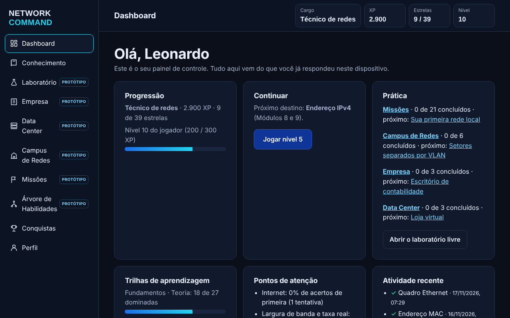
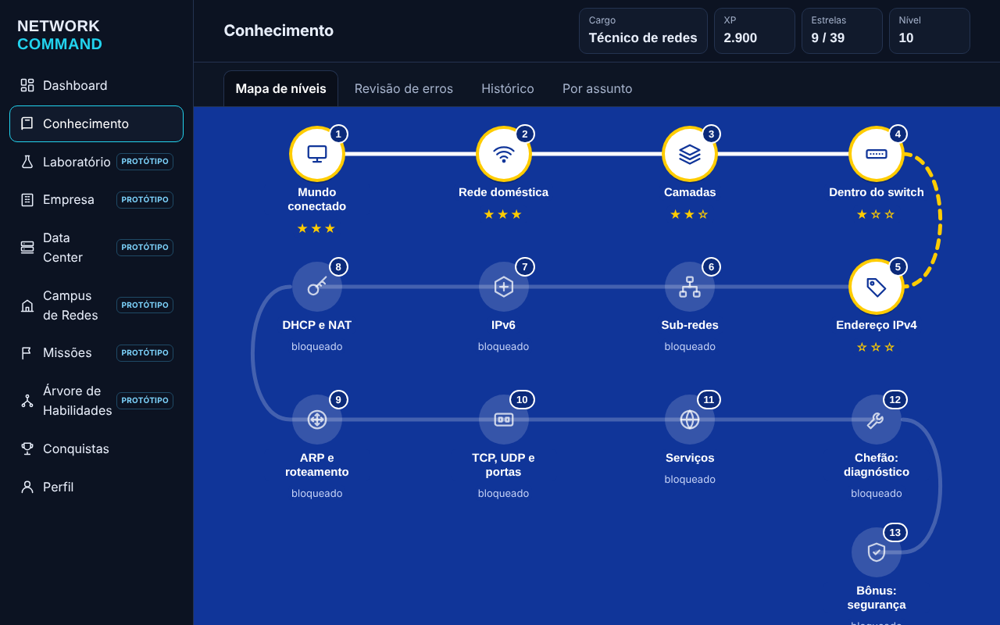
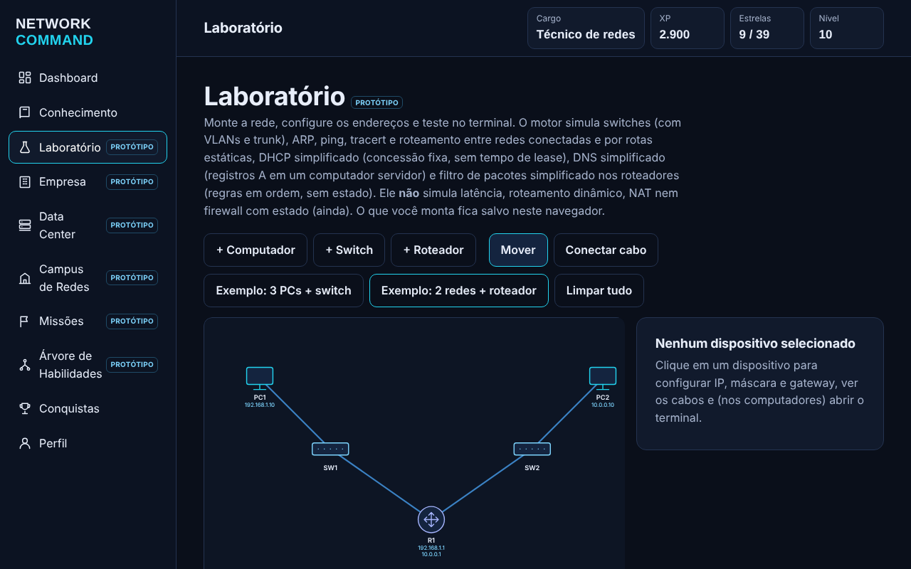
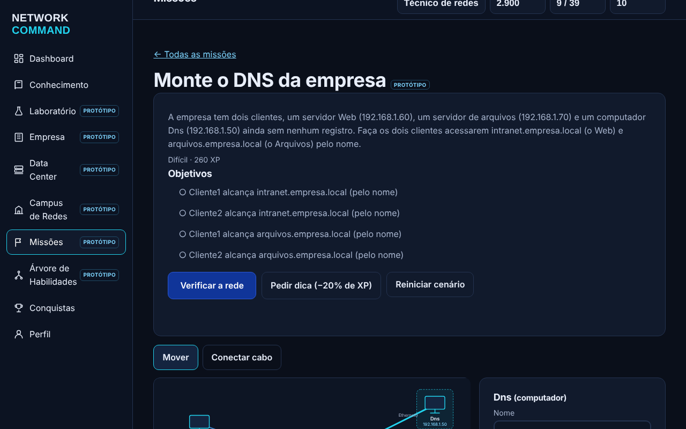
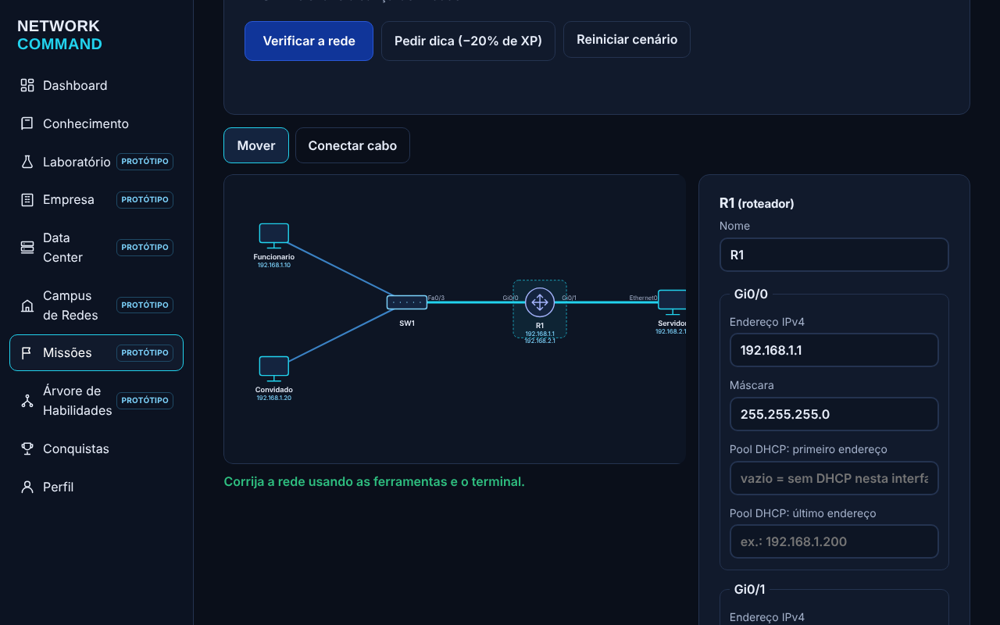
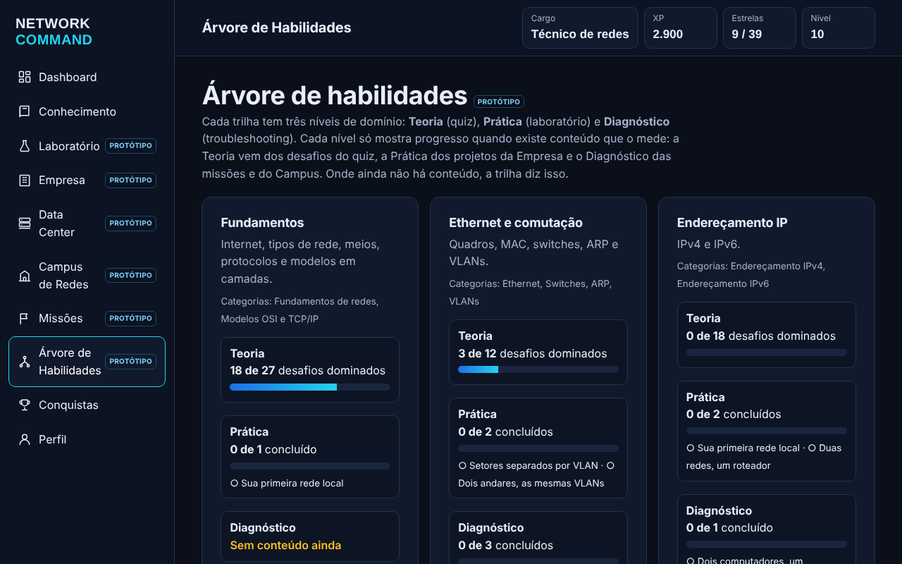

# Network Command

[](https://github.com/leonardofacin707-lab/network-command/actions/workflows/publicar.yml) [](https://github.com/leonardofacin707-lab/network-command/actions/workflows/codeql.yml) [](https://scorecard.dev/viewer/?uri=github.com/leonardofacin707-lab/network-command)

**Jogar agora:** https://leonardofacin707-lab.github.io/network-command/ (funciona no celular e sem internet depois da primeira visita)

Plataforma gamificada para aprender redes de computadores, feita em **JavaScript puro** (HTML, CSS e ES modules; sem frameworks e sem dependências em produção).
Projeto de portfólio de Leonardo Facin, baseado nos tópicos do curso *Conceitos Básicos de Redes* (Cisco Networking Academy).
É um projeto independente de estudo: **não é afiliado à Cisco e não emite certificado oficial**.

## O que tem

| Módulo | O que faz | Estado |
|---|---|---|
| Conhecimento | Quiz em 12 níveis mais 1 bônus (117 desafios marcados pelo módulo do curso), desafio do dia, simulado com tempo por módulo, treino por módulo, revisão espaçada e exercícios sem fim de sub-redes e IPv6 | pronto |
| Laboratório | Editor visual de rede, IPv4 e IPv6 (SLAAC, descoberta de vizinhos), Wi-Fi (WPA2/WPA3), VLANs, rotas estáticas, OSPF, DHCP, filtro por protocolo e porta, DNS, NAT, serviços TCP, captura de pacotes, animação do pacote, terminal (ping, tnc…) e console estilo Cisco IOS, sobre um motor de simulação próprio | protótipo |
| Missões e Campus | 49 cenários de defeitos e de ataque e defesa (DHCP falso, gateway falso, DNS falso, Telnet), verificados pelo motor | protótipo |
| Empresa | Planejamento de sub-redes (VLSM), portas e orçamento | protótipo |
| Data Center | Disponibilidade em série e paralelo, custo e portas | protótipo |
| Habilidades, Conquistas, Perfil | Progressão única (XP, nível, árvore, conquistas) salva no navegador | pronto |

"Protótipo" quer dizer que as regras são reais e testadas, mas o escopo é simplificado (os limites estão em [docs/REGISTRO.md](docs/REGISTRO.md)). Nada é gravado fora do navegador (localStorage) e não há senhas nem dados pessoais.

## Capturas de tela

As capturas abaixo usam um progresso de exemplo semeado só para ilustrar (não é um histórico real de uso).

| | |
|---|---|
|  |  |
|  |  |
|  |  |

## Como rodar

O projeto usa módulos ES e arquivos JSON, então precisa de um servidor HTTP (abrir o `index.html` direto do disco não funciona):

```bash
npm run serve      # http://localhost:5173
```

Também funciona com a extensão Live Server do VS Code.

## Publicar (GitHub Pages)

```bash
npm run build        # gera dist/ só com o que vai para o ar, com CSP e modo offline
npm run serve:dist   # confere a versão de publicação em http://localhost:5174
```

O fluxo `.github/workflows/publicar.yml` faz isso sozinho: a cada envio para a `main` ele procura segredos no histórico, audita as dependências, roda todos os testes e só então publica `dist/` no GitHub Pages. Para ligar, no repositório: **Settings → Pages → Source: GitHub Actions**.

Na versão publicada o jogo pode ser instalado no celular ("Adicionar à tela inicial") e funciona sem internet depois da primeira visita.

## Segurança e privacidade

Nenhum dado do jogador sai do aparelho: não há cadastro, servidor de jogo, rastreadores nem recursos de outros sites. Detalhes em [SECURITY.md](SECURITY.md) e na página [privacidade.html](privacidade.html).

## Licença

Código com todos os direitos reservados, visível para avaliação do portfólio (ver [LICENSE](LICENSE)). As fontes seguem a SIL Open Font License.

## Testes

```bash
npm install                     # só instala o playwright-core (testes no navegador)
npm run test:unit               # regras puras e motor de simulação: pontuação, estado salvo, IPv4, ARP, ping, missões
CHROME_PATH=/caminho/do/chrome npm run test:e2e   # navegador real: um robô joga pela interface
ALVO=legacy npm run test:e2e    # mesmos testes contra a v0.1 congelada (legacy/)
```

## Estrutura

Veja [docs/ARQUITETURA.md](docs/ARQUITETURA.md). O que já funciona e o que falta: [docs/REGISTRO.md](docs/REGISTRO.md).
